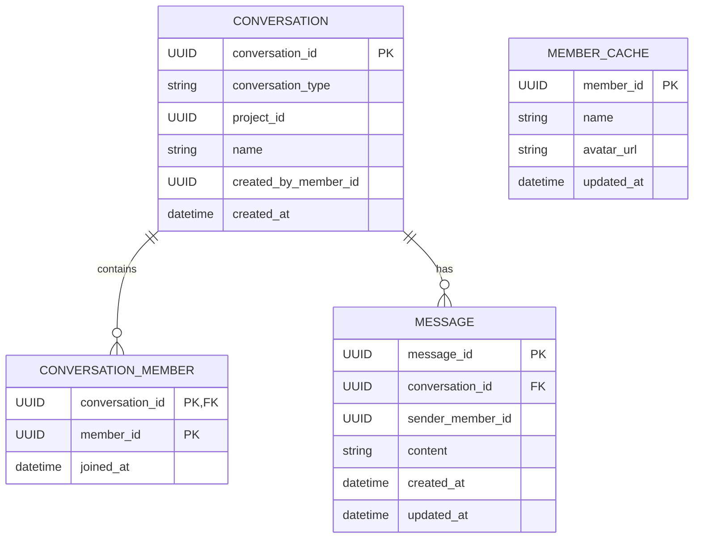

# Chat Service – ER Diagram

A conversation can represent either a project channel or a direct conversation.

Member IDs and project IDs refer to information owned by other services. The Chat Service does not maintain its own Member or Project tables.
