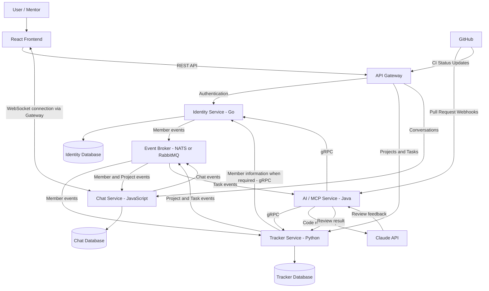

# Forge – Service Map

## Service Responsibilities

- **Identity Service:** Owns member accounts, authentication and roles.
- **Tracker Service:** Owns projects, milestones, tasks, comments and task activity.
- **Chat Service:** Manages project channels, direct messages and real-time communication.
- **AI/MCP Service:** Provides MCP tools, AI agents and Claude-powered code reviews.
- **API Gateway:** Acts as the public entry point and routes frontend requests.
- **Event Broker:** Enables asynchronous communication between services.

## Communication Principles

- Each stateful service owns its own PostgreSQL database.
- Services communicate synchronously through gRPC when an immediate response is required.
- Events are used for asynchronous updates and to maintain local member caches.
- WebSockets provide real-time messaging.
- Services never directly access another service's database.
