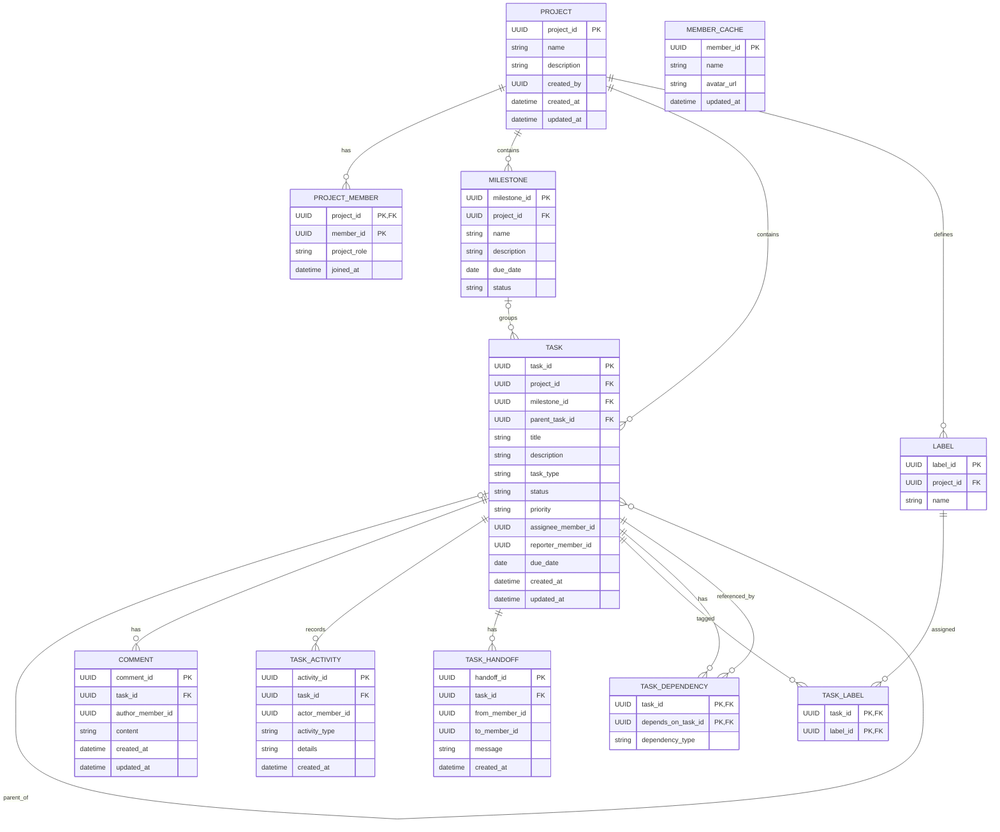

# Tracker Service – ER Diagram

Member IDs refer to members owned by the Identity Service. They are not foreign keys to another service's database.

Both task_id and depends_on_task_id in TASK_DEPENDENCY refer to records in the Tracker Service's own TASK table.
